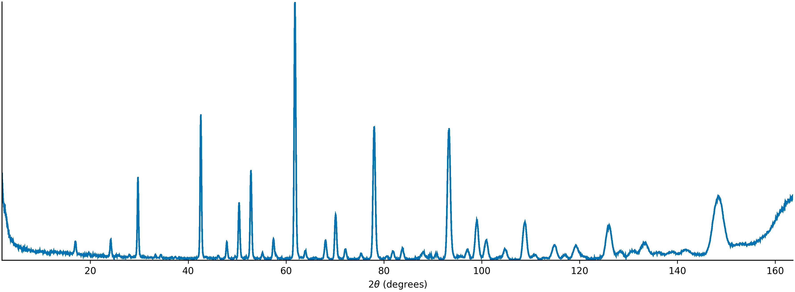
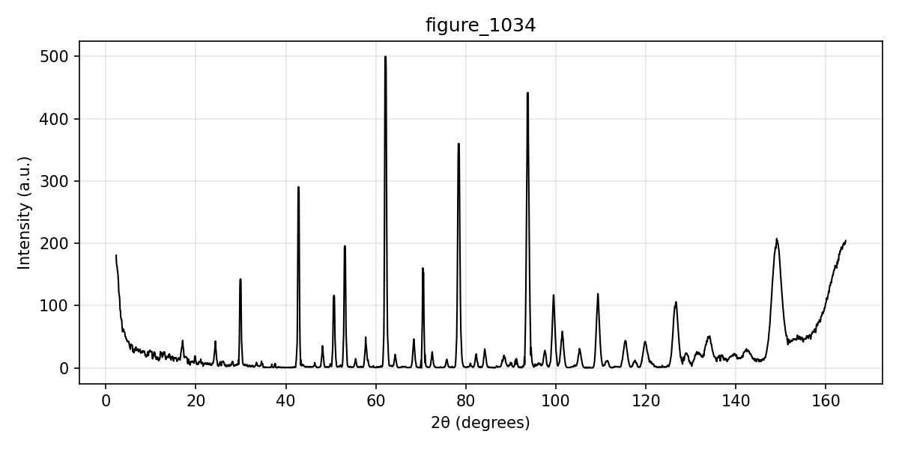
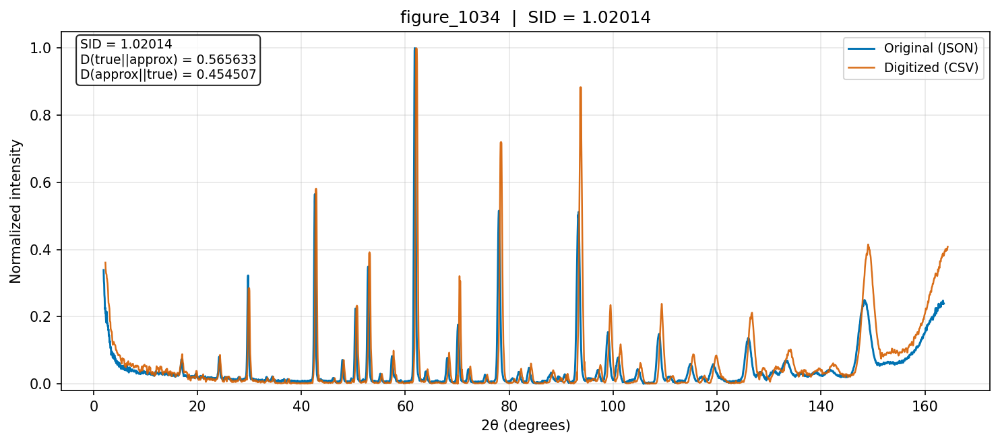
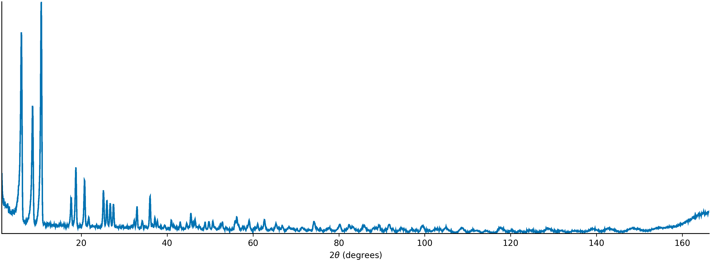
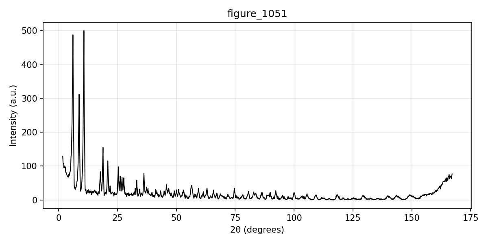
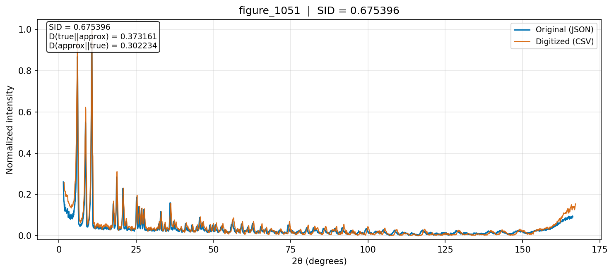
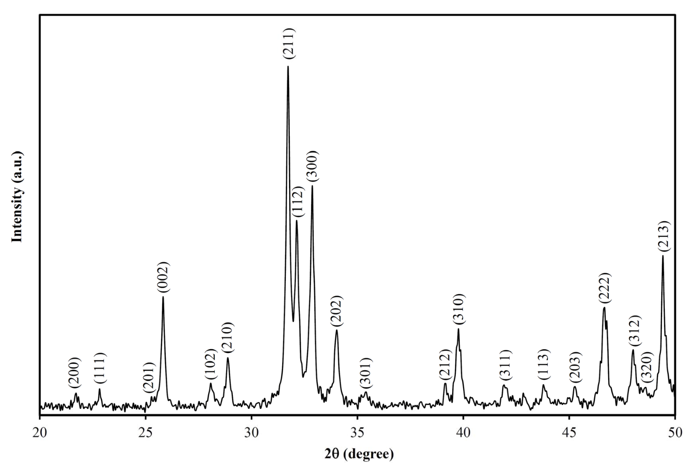
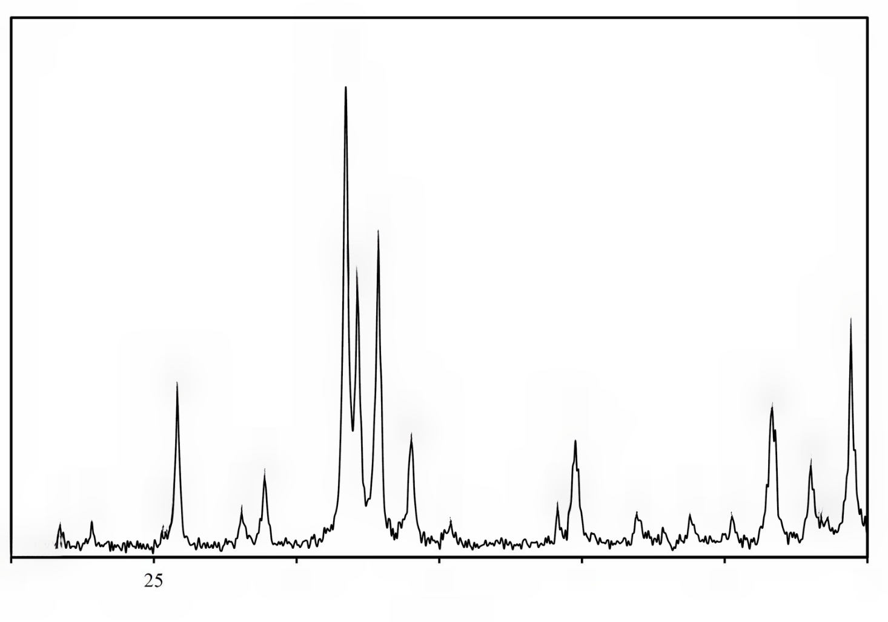
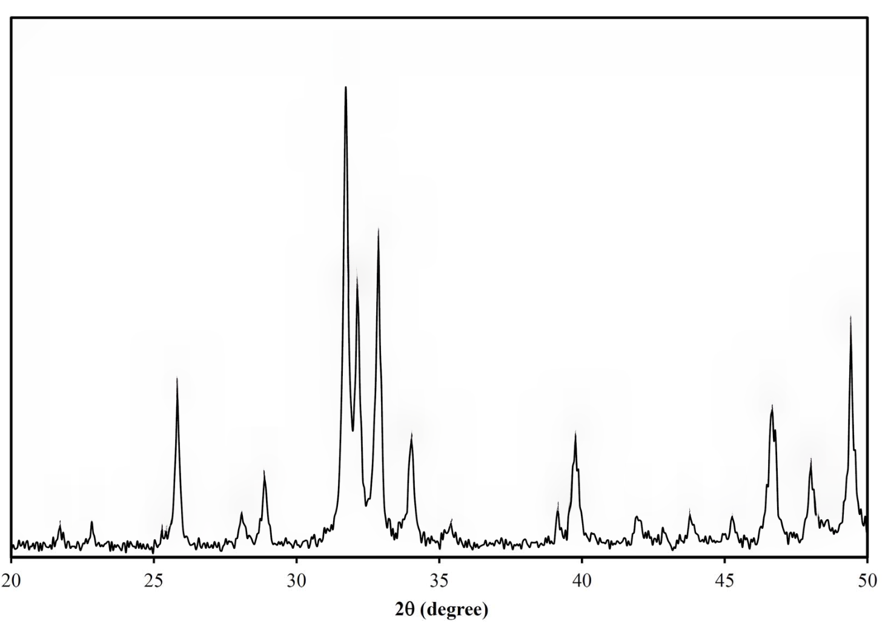
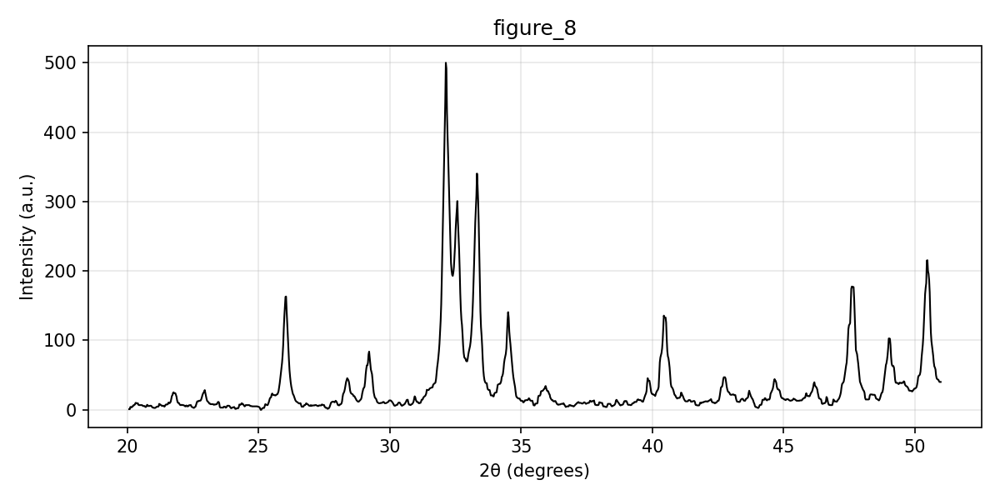

# XRD PDF Scraping

Extract figures, captions, and surrounding context from scientific PDFs, then enrich each crop with structured vision analysis. The default path stops at scrape + metadata — curve digitization is an optional bonus.

```
PDF → GROBID parse → figure crops + captions + context
    → OpenAI vision analysis → <stem>.figure_analysis.json
    → (optional) --digitize → calibrated CSV / preview PNGs
```

**Recommended for new users:** run with Docker (no Python install, no local build). See [Quick Start with Docker](#quick-start-with-docker).

---

## Quick Start with Docker

You need [Docker Desktop](https://docs.docker.com/get-docker/) (macOS / Windows) or Docker Engine + the Compose plugin (Linux). You do **not** need to install Python or clone this repository to process PDFs — only Docker, an OpenAI API key, and a place to put input/output files.

### 1. Install Docker

- macOS / Windows: install [Docker Desktop](https://www.docker.com/products/docker-desktop/) and start it.
- Linux: install Docker Engine and the Compose plugin, then confirm with `docker compose version`.

### 2. Get the Compose file and folders

Either clone the repo, or download only [`compose.yaml`](compose.yaml) into an empty working directory:

```bash
mkdir -p xrd-work && cd xrd-work
# If you cloned the repo, you already have compose.yaml.
# Otherwise download it, then:
mkdir -p papers results
```

Put the PDF(s) you want to process into `papers/`.

### 3. Pull images and start GROBID

```bash
docker pull keanu375/xrd-pipeline:v3
docker pull grobid/grobid:0.9.0-crf

docker compose up -d grobid
```

GROBID needs ~30–60s to become healthy on first start. You can confirm with:

```bash
curl http://localhost:8070/api/isalive
# expect: true
```

`docker compose run --rm xrd` also waits until GROBID is healthy before starting.

### 4. Set your OpenAI API key

```bash
export OPENAI_API_KEY=sk-...   # your key; never commit this
```

Compose reads `OPENAI_API_KEY` from your environment. Do not hardcode keys in `compose.yaml`.

### 5. Process PDFs

Process every PDF under `papers/` and write results to `results/`:

```bash
docker compose run --rm xrd
```

Process a single file (paths are inside the container; `papers/` and `results/` are mounted from your host):

```bash
docker compose run --rm xrd python scripts/scrape_and_digitize.py \
  papers/my_paper.pdf results/ --grobid-url http://grobid:8070 --overwrite
```

Optional digitization (same flags as local runs):

```bash
docker compose run --rm xrd python scripts/scrape_and_digitize.py \
  papers/ results/ --grobid-url http://grobid:8070 --digitize
```

### Expected output

For each PDF, the pipeline writes `results/<stem>/`:

| Path | Contents |
|------|----------|
| `xrd_figures/<id>.png` | Crops classified as XRD-related |
| `non_xrd_figures/<id>.png` | Crops classified as not XRD |
| `<stem>.figure_analysis.json` | Per-figure path, caption, paper context, and `analysis` metadata |
| `extra/` | Original PDF plus GROBID TEI / parse records |

Digitization is **off** unless you pass `--digitize` (then XRD crops are triaged under `xrd_figures/` and CSVs / preview PNGs are added).

Stop GROBID when finished: `docker compose down`.

### Alternative: `docker run` (no Compose file)

Use this when GROBID is published on the host (`-p 8070:8070`). Containers reach the host via `host.docker.internal` (Docker Desktop; on Linux add `--add-host=host.docker.internal:host-gateway`).

```bash
mkdir -p papers results
# copy PDFs into ./papers

docker run -d --name grobid --init -p 8070:8070 grobid/grobid:0.9.0-crf

# wait until: curl http://localhost:8070/api/isalive → true

docker run --rm \
  -e OPENAI_API_KEY \
  -v "$PWD/papers:/app/papers:ro" \
  -v "$PWD/results:/app/results" \
  --add-host=host.docker.internal:host-gateway \
  keanu375/xrd-pipeline:v3 \
  python scripts/scrape_and_digitize.py papers/ results/ \
  --grobid-url http://host.docker.internal:8070
```

**Networking:** with Docker Compose, use the service hostname `http://grobid:8070`. With separate `docker run` containers talking through the host port, use `http://host.docker.internal:8070`.

### Optional: Kubernetes

Kubernetes manifests under [`k8s/`](k8s/) are for advanced / batch deployments (shared GROBID service, Jobs, PVC output). Prefer Docker Compose for local use. See that directory for GROBID, storage, and Job examples that use `keanu375/xrd-pipeline:v3`.

---

## Local Development

For contributors who want to edit the pipeline code locally:

```bash
git clone --recurse-submodules git@github.com:KeanuNakamura/xrd-digitization.git
cd xrd-digitization
python3 -m venv .venv && source .venv/bin/activate
python -m pip install --upgrade pip
python -m pip install -r requirements.txt
```

If you already cloned without submodules: `git submodule update --init`.

Requires a running [GROBID](https://grobid.readthedocs.io/) server (for example `docker compose up -d grobid`) and `OPENAI_API_KEY` for figure analysis.

To rebuild the pipeline image from this source tree instead of pulling the published tag:

```bash
docker build -t xrd-pipeline:local .
```

## Usage

### PDF → scrape → analysis (default)

```bash
export OPENAI_API_KEY=...

python scripts/scrape_and_digitize.py paper.pdf output/
python scripts/scrape_and_digitize.py pdf_files/ output/
```

For each PDF, writes `output/<stem>/`:

| Path | Contents |
|------|----------|
| `xrd_figures/<id>.png` | Crops classified as XRD-related |
| `non_xrd_figures/<id>.png` | Crops classified as not XRD |
| `<stem>.figure_analysis.json` | Per-figure path, caption, paper context, and `analysis` metadata |
| `extra/` | Original PDF plus GROBID TEI / parse records |

Digitization is **off** unless you pass `--digitize`.

### Output shape

Each entry in `<stem>.figure_analysis.json` looks like:

```json
{
  "figure": 1,
  "figure_path": "figures/fig_1.png",
  "caption": "Figure 1. XRD spectra as a function of …",
  "text": "…surrounding paper context…",
  "analysis": {
    "is_xrd": true,
    "sample": "…",
    "composition": ["TiO2"],
    "space_group": ["P42/mnm"],
    "curves": [{
      "condition": "…",
      "composition": ["TiO2"],
      "space_group": ["P42/mnm"],
      "peak_positions": [],
      "phases": []
    }],
    "trends": ["…"]
  }
}
```

`composition` and `space_group` are literature-only lists (empty unless the paper states them). They appear at both figure and curve level.

Paper-level synthesis (when available) is stored alongside as `paper_analysis`.

See [`examples/scrape/`](examples/scrape/) for sample XRD crops and a portable JSON sketch, and [`examples/DEMO.md`](examples/DEMO.md) for a walkthrough.

### Useful flags

| Flag | Effect |
|------|--------|
| `--grobid-url URL` | GROBID base URL (default `http://localhost:8070`) |
| `--figure-dpi N` | Render DPI for crops (default `300`) |
| `--model NAME` | OpenAI vision model override |
| `--overwrite` | Replace an existing `output/<stem>/` |
| `--benchmark` | Crop all figures, classify XRD vs not, copy into global `xrd/` / `not_xrd/` (no digitize) |
| `--digitize` | After scrape+analysis, triage and digitize XRD curves (bonus) |
| `--all-figures` | With `--digitize`: digitize every crop, not only XRD-classified ones |

### Analyze already-cropped figures

```bash
export OPENAI_API_KEY=...
python scripts/analyze_figures.py path/to/figure_pngs/ output/figure_metadata/
```

## Demo

The nanosized-powders paper mixes TEM, SAXS, and XRD. After scrape + analysis, the XRD-related crops (e.g. figures 1 and 5) land under `xrd_figures/` with captions and context in `figure_analysis.json`:

<table>
  <tr>
    <td align="center"><strong>Figure 1</strong><br/></td>
    <td align="center"><strong>Figure 5</strong><br/></td>
  </tr>
</table>

Full walkthrough: [`examples/DEMO.md`](examples/DEMO.md).

---

## Bonus: curve digitization

Optional path that turns a single-curve (or stacked shared-x) XRD PNG into calibrated `(x, y)` CSV plus a preview PNG. Needs [Tesseract](https://github.com/tesseract-ocr/tesseract) for axis OCR (`brew install tesseract` on macOS). `CLIPDROP_API_KEY` is only required when in-plot text must be removed. The published Docker image already includes Tesseract.

### End-to-end with scrape

```bash
export OPENAI_API_KEY=...
export CLIPDROP_API_KEY=...   # only if a figure needs ClipDrop

python scripts/scrape_and_digitize.py paper.pdf output/ --digitize
```

With Docker Compose:

```bash
docker compose run --rm -e CLIPDROP_API_KEY xrd python scripts/scrape_and_digitize.py \
  papers/ results/ --grobid-url http://grobid:8070 --digitize
```

With `--digitize`, crops already under `xrd_figures/` are triaged and digitized (use `--all-figures` to also digitize `non_xrd_figures/`).

### Digitize one PNG

```bash
python scripts/digitize_figure.py examples/figure_3.png output/
# → output/figure_3/figure_3.csv
# → output/figure_3/figure_3_digitized.png
```

Add `--clipdrop` to remove in-plot text before tracing (uses ClipDrop credits).

### Digitization examples

CNRS figure 1034 — original, reconstructed curve, overlay (SID ≈ 1.02):

<table>
  <tr>
    <td align="center" width="33%"><strong>Original</strong></td>
    <td align="center" width="33%"><strong>Digitized</strong></td>
    <td align="center" width="33%"><strong>Overlay</strong></td>
  </tr>
  <tr>
    <td align="center"></td>
    <td align="center"></td>
    <td align="center"></td>
  </tr>
</table>

CNRS figure 1051 — original, reconstructed curve, overlay (SID ≈ 0.68):

<table>
  <tr>
    <td align="center" width="33%"><strong>Original</strong></td>
    <td align="center" width="33%"><strong>Digitized</strong></td>
    <td align="center" width="33%"><strong>Overlay</strong></td>
  </tr>
  <tr>
    <td align="center"></td>
    <td align="center"></td>
    <td align="center"></td>
  </tr>
</table>

#### Figures with in-plot text

With `--clipdrop`, in-plot labels are cleared, then the cleaned interior is pasted back onto the original axes so tick OCR still works:

<table>
  <tr>
    <td align="center" width="25%"><strong>Original</strong></td>
    <td align="center" width="25%"><strong>Clean</strong></td>
    <td align="center" width="25%"><strong>Axes restored</strong></td>
    <td align="center" width="25%"><strong>Digitized</strong></td>
  </tr>
  <tr>
    <td align="center"></td>
    <td align="center"></td>
    <td align="center"></td>
    <td align="center"></td>
  </tr>
</table>

> Monshi, A., Foroughi, M. R., & Monshi, M. R. (2012). Modified Scherrer Equation to Estimate More Accurately Nano-Crystallite Size Using XRD. *World Journal of Nano Science and Engineering*, *2*, 154–160. https://doi.org/10.4236/wjnse.2012.23020

### Spectral Information Divergence (SID)

SID scores digitized spectra against ground truth (`compute_sid.py`). Lower is better; overlays report raw/modified SID, peak F1, and a final XRD score written to `<figure_id>_scores.json` / `sid_summary.json`.
