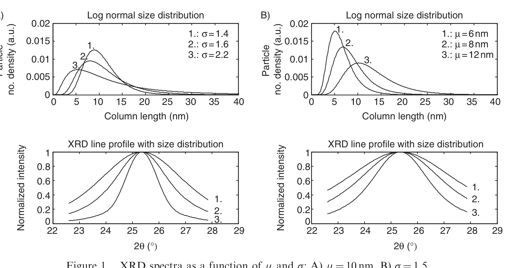
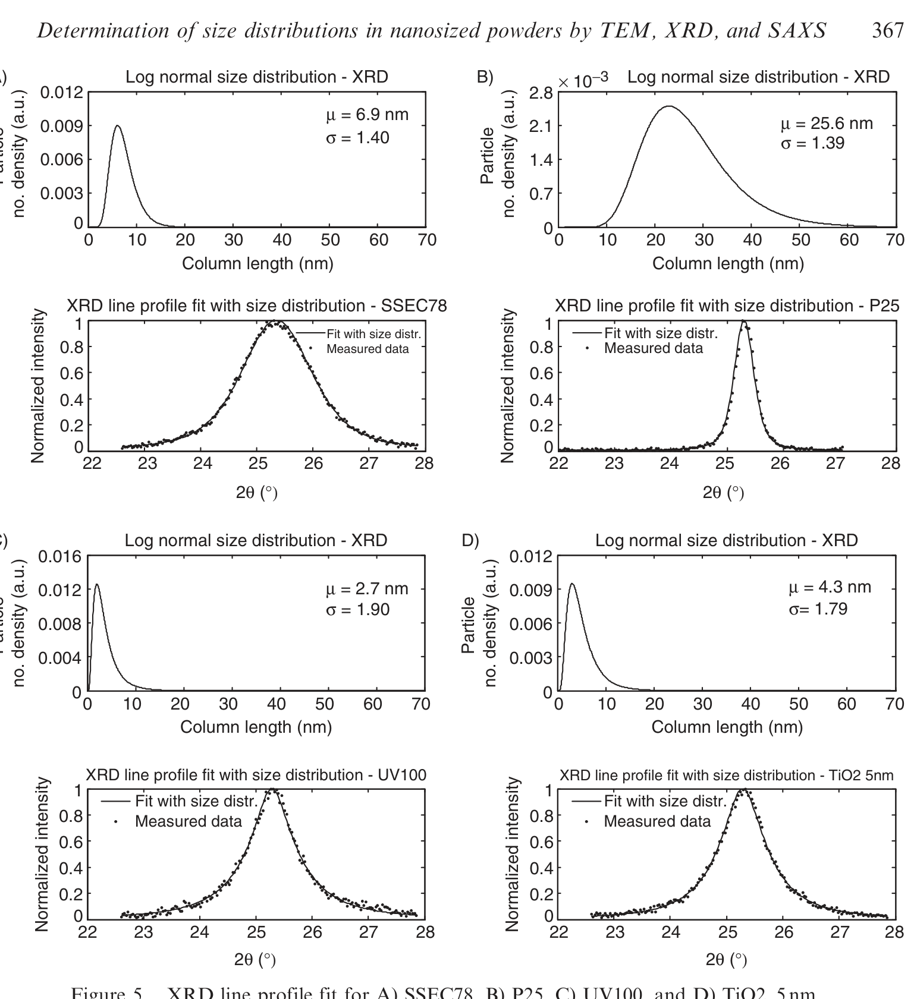

# Demo: PDF scrape → figure analysis

This walkthrough focuses on the **default pipeline**: parse a PDF with GROBID, crop figures, attach captions/context, and enrich each crop with OpenAI vision analysis. Digitization is optional (`--digitize`) and covered briefly at the end.

## What you need

- GROBID running (default `http://localhost:8070`)
- `OPENAI_API_KEY` set
- A materials/XRD paper PDF (locally, `demo/nanosized_powders.pdf` is a convenient example)

## Run

```bash
export OPENAI_API_KEY=...

python scripts/scrape_and_digitize.py path/to/paper.pdf output/
```

Do **not** pass `--digitize` for this demo — scrape + analysis only.

## What you get

```
output/<stem>/
  figures/
    fig_1.png
    fig_5.png
    …
  <stem>.figure_analysis.json
  extra/          # PDF + GROBID TEI / parse records
```

### Sample crops (nanosized powders)

The paper discusses TEM, SAXS, and XRD size-distribution methods. The scraper extracts every figure crop; vision analysis fills `analysis.is_xrd` and related fields so you can filter to XRD later (or use `--benchmark` / `--digitize` for XRD-oriented staging).

| Figure 1 | Figure 5 |
|----------|----------|
|  |  |

### `figure_analysis.json`

Each list entry ties a crop to caption, surrounding text, and structured `analysis`:

```json
{
  "figure": 1,
  "figure_path": "figures/fig_1.png",
  "caption": "Figure 1. XRD spectra as a function of …",
  "text": "…nearby paragraphs used as context…",
  "analysis": {
    "is_xrd": true,
    "sample": "…",
    "curves": [],
    "trends": []
  }
}
```

A portable sketch of this shape (with truncated text) lives at [`scrape/figure_analysis.sample.json`](scrape/figure_analysis.sample.json).

## Related modes

```bash
# Classify every crop into global xrd/ vs not_xrd/ (no digitization)
python scripts/scrape_and_digitize.py paper.pdf output/ --benchmark

# Bonus: after scrape+analysis, triage and digitize XRD curves
python scripts/scrape_and_digitize.py paper.pdf output/ --digitize
```

See the main [README](../README.md) for output layout details and the digitization bonus section.
